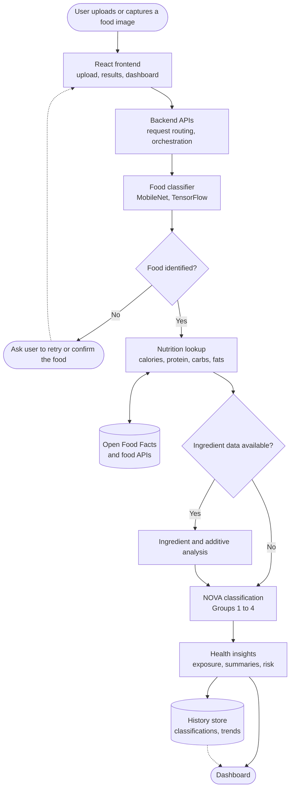
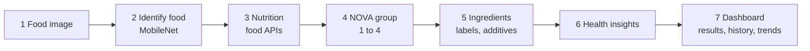

# Nova Food Classifier

**An AI-powered food analysis and food safety platform that goes beyond "what is this food?" to "how good is it for me?"**

Upload or capture a photo of food. The app identifies it, pulls its nutrition, classifies how heavily processed it is on the **NOVA scale**, checks ingredients and additives where data exists, and tracks your exposure to ultra-processed food over time.


<!-- Add a screenshot or GIF: docs/demo.gif -->

## What it does

1. **Food identification:** classify an uploaded or captured image with the deep learning model (TensorFlow, MobileNet).
2. **Nutrition analysis:** fetch calories, protein, carbohydrates, fats and other available nutrients from food APIs.
3. **NOVA classification:** assign Group 1 to 4 by degree of processing, flagging ultra-processed foods.
4. **Ingredient analysis:** examine ingredient labels and additives when the data is available.
5. **Health insights:** processed-food exposure tracking, nutritional summaries and metabolic-health risk indicators.
6. **Dashboard:** analysis results, nutrition breakdowns, classification history and trends.

## System architecture

Boxes are components, diamonds are decisions.



> Adjust the box names to match your actual services and folders. The retry path and the ingredient-data check are assumptions to confirm against the code.

## Pipeline



Steps 5 and 6 use ingredient data only when it is available.

## NOVA classification

NOVA groups foods by how much industrial processing they have had, not by nutrients alone.

| Group | Meaning | Examples |
|---|---|---|
| 1 | Unprocessed or minimally processed | Fruit, vegetables, eggs, plain milk |
| 2 | Processed culinary ingredients | Oil, butter, sugar, salt |
| 3 | Processed foods | Canned vegetables, simple breads, cheese |
| 4 | **Ultra-processed foods** | Soft drinks, packaged snacks, instant noodles |

Group 4 is the focus: frequent consumption is associated with poorer metabolic health outcomes. The app reports risk **indicators** for awareness, not diagnoses.

## Tech stack

| Layer | Technology |
|---|---|
| Frontend | React |
| ML | TensorFlow, MobileNet food image classifier |
| Backend | APIs serving classification, nutrition and history |
| Data | Open Food Facts and other food databases |

## Feature status

Fill this in from the codebase so readers see what is real today.

| Feature | Status |
|---|---|
| Image classification (MobileNet) | Working |
| Nutrition lookup | _confirm_ |
| NOVA classification | _confirm_ |
| Ingredient and additive analysis | _confirm_ |
| Processed-food exposure tracking | _confirm_ |
| Dashboard and history | _confirm_ |

## Getting started

```bash
git clone https://github.com/<your-username>/<repo>.git
cd <repo>

# backend
cd backend
pip install -r requirements.txt
python app.py              # adjust entry point

# frontend
cd ../frontend
npm install
npm start                  # or npm run dev
```

Add API keys to a `.env` file if your food APIs need them, and never commit it.

## Limitations

- Image recognition identifies the food type; it cannot see ingredients, so ingredient and NOVA analysis depend on database data and may be unavailable for unlabelled or homemade food.
- Nutrition values are estimates based on database entries and portion assumptions.
- Health indicators are informational and not medical advice.

## Roadmap

- [ ] Barcode scanning for exact product data
- [ ] Portion-size estimation from images
- [ ] Personalised exposure goals and weekly summaries
- [ ] Wider food-class coverage and model retraining

## Author

Amodh
